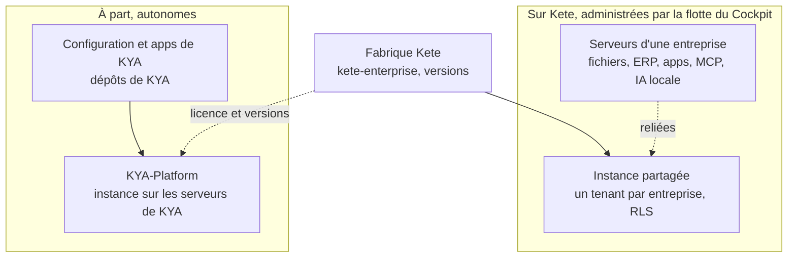

# Architecture

> Ce qui est **tranché** renvoie à une décision (`D-xxx`). Ce qui est marqué **proposition** attend
> la validation de l'auteur.

## 1. Les principes d'architecture

1. **Générique d'abord (D-014).** Le code métier parle à des **ports** (interfaces) ; les
   fournisseurs vivent dans des **adaptateurs**. Aucun nom de fournisseur dans le domaine.
2. **Le contrat d'abord.** Les échanges entre services sont décrits en JSON Schema versionné ;
   les types TypeScript et Python en sont générés.
3. **Chaque app est un monolithe modulaire** : domaine, application, infrastructure. Ses surfaces
   (web, API, MCP, worker) appellent les mêmes services applicatifs.
4. **L'organisation est la frontière.** Chaque table porte l'organisation, avec RLS écrite dans la
   migration qui crée la table.
5. **Chaque app reste autonome.** Elle a sa base, son outbox, ses rôles métier ; elle continue de
   servir ses utilisateurs connectés si Kete Cockpit ou un guichet tombe.
6. **Une base par service**, jamais de lecture dans la base d'un autre : on se référence par
   identifiant (personne, organisation, produit).
7. **Tout changement de code passe par Pono.**

## 2. La carte du système

| Service | Pour qui | Rôle |
|---|---|---|
| **Compte Kete** | Tout le monde | Identité, organisations, rôles d'organisation, abonnements (proposition), paramètres génériques, OAuth pour les apps et le MCP |
| **Mon espace Kete** (D-013) | Le client | Le centre unique : ses apps, son organisation, ses abonnements, ses paramètres |
| **Kete Apps** | Le client et ses équipes | Firmo, Nettio, Nyatefe : le métier |
| **Kete Enterprise** (D-025 à D-028) | Les employés et la direction d'une entreprise | La chaîne de l'entreprise : structure, droits, décisions, ressources, agents (§13) |
| **Kete Cockpit** | L'équipe Kete (puis d'autres porteurs de produits) | Administrer les produits : événements, santé, brief, points d'attention ; la flotte de Kete Enterprise (D-027) |
| **Guichets MCP** | Les agents | Kete Ops pour l'équipe, Kete pour les clients |
| **Pono** | Ceux qui construisent | Le chemin sûr des changements de code |

## 3. Le Compte Kete (D-011)

- Construit sur **Better Auth**, dans un service à lui : `compte.kete.africa` (nom à confirmer).
- **Connexion par e-mail** par défaut (mot de passe ou lien magique) ; téléphone plus tard.
- **Organisations** : une entreprise cliente est une organisation, avec ses membres et un rôle
  d'organisation (propriétaire, administrateur, membre).
- **Fournisseur d'identité** pour toutes les apps (connexion unique) et **serveur d'autorisation
  OAuth** pour le MCP.
- **Le jeton** transporte : la personne, l'organisation active, son rôle d'organisation, les apps
  auxquelles l'organisation a accès.
- **Opérateurs Kete** : identité séparée, double authentification obligatoire.
- **Kete Enterprise** : sur l'instance partagée, l'organisation du Compte Kete est le tenant de
  l'entreprise, et le Compte Kete est l'identité de ses employés (D-028).

## 4. Mon espace Kete (D-013)

Le centre unique du client, servi par le Compte Kete :

- **Mes outils** : les liens vers ses apps Kete, avec leur état.
- **Mon organisation** : membres, invitations, rôle d'organisation de chacun.
- **Mes abonnements** : apps, formules, échéances, factures, paiement (via le port de paiement).
- **Paramètres génériques, saisis une fois, utilisés partout** :
  - identité de l'entreprise : nom, logo, adresse, contacts, identifiants légaux (RCCM, NIF) ;
    Firmo s'en sert pour l'en-tête des devis, Nettio pour ses tickets ;
  - langue, fuseau horaire, devise ;
  - canaux de notification préférés (e-mail, WhatsApp, Telegram).
- **Sécurité** : sessions actives, double authentification.
- **Mes données** : export, suppression, et le journal des accès du support Kete.
- **Besoin d'aide** : le bouton de retour, relié au support.

Chaque app garde ses **paramètres propres** (tarifs d'un pressing, modèles de devis) chez elle.

## 5. Les rôles, sur trois niveaux

| Niveau | Où | Exemple |
|---|---|---|
| Organisation | Compte Kete | Propriétaire, administrateur, membre ; apps accessibles |
| Métier | Dans chaque app | Nettio : gérant, caissier, atelier, livreur, par agence |
| Agent | Le jeton de la personne | Jamais plus de droits que la personne ; échelle d'autonomie |

L'accès d'un opérateur Kete au compte d'un client est limité dans le temps, motivé, audité et
**visible par le client** dans Mon espace Kete.

## 6. Les ports et leurs adaptateurs (D-014)

| Port | Premier adaptateur | Suivants possibles |
|---|---|---|
| Paiement | **Chariow** (D-012) | Moneroo, Stripe |
| Messages | E-mail transactionnel (Brevo ou Resend) | WhatsApp, Telegram, via Novu |
| Identité (côté app) | Compte Kete | Identité du socle pour Kete Enterprise |
| Fichiers | Stockage S3 (Neon ou autre) | Garage, SeaweedFS |
| Modèle d'IA | Claude | Tout autre modèle : les skills restent portables |
| Hébergement | Coolify | — |
| Code et changements | GitHub, via Pono | — |
| Secrets | Variables Coolify, puis Infisical | — |
| Surveillance | Uptime Kuma, GlitchTip | — |

## 7. Le paiement (D-012)

1. Le client choisit une formule dans Mon espace Kete (ou depuis une app).
2. Le port de paiement crée une session de paiement chez **Chariow** et renvoie le lien.
3. Le client paie sur la page Chariow.
4. Chariow notifie le Compte Kete (webhook « Pulses »), qui vérifie la vente auprès de Chariow.
5. L'abonnement de l'organisation devient actif ; le prochain jeton porte l'accès à l'app.
6. Un événement `payment.succeeded` part vers Kete Cockpit par l'outbox.

**Proposition** : la facturation des apps Kete est **centralisée dans le Compte Kete** (un client,
un compte, une facture, et des offres groupées possibles). Les apps lisent l'accès dans le jeton et
gardent un délai de grâce si le Compte Kete est momentanément injoignable.

## 8. Les contrats et les événements

| Contrat | Contenu |
|---|---|
| `manifest.v1` | Identité de l'app, environnements, santé, événements émis, capacités |
| `event.v1` | Enveloppe d'événement signée (HMAC horodaté) |
| `health.v1` | État de l'app et de ses dépendances |
| `admin.v1` | API de l'espace opérateur |
| `capability.v1` | Un geste métier exposé par MCP, avec son niveau d'autonomie |

Événements standard : `account.created`, `account.activated`, `payment.succeeded`,
`payment.failed`, `subscription.renewal_due`, `account.closed`, `metrics.daily`. Aucune donnée
métier détaillée ne quitte l'app : des faits et des compteurs.

## 9. Kete Cockpit

- **Détient** : registre des produits, événements, sondes, instantanés quotidiens, points
  d'attention, échéances, briefs, audit.
- **Flux** : événements (app vers Cockpit, par l'outbox), santé (Cockpit vers `/health`, chaque
  minute), manifeste (chaque jour), instantanés (chaque nuit), brief (8 h, Telegram), MCP Kete Ops
  (à la demande), surveillance externe par Uptime Kuma (VPS séparé).
- **Flotte** (D-027) : un module réservé aux opérateurs Kete pour les tenants de l'instance
  partagée de Kete Enterprise et les instances opérées par Kete. Il ne lit jamais les données
  métier d'un client.
- **Plus tard** : déploiements et erreurs reliés aux incidents, espace opérateur, fiche client
  transverse, revenus, rapports, ouverture à d'autres porteurs de produits.

## 10. L'architecture interne d'une app

```
Surfaces      web (PWA) · API · MCP · worker
Application   cas d'usage : « créer un dépôt », « préparer un devis »
Domaine       règles du métier, sans aucun fournisseur
Ports         paiement, messages, fichiers, identité, événements, IA
Adaptateurs   Chariow, e-mail, S3, Compte Kete, outbox, modèle d'IA
```

Chaque app reçoit du châssis : connexion au Compte Kete, outbox et événements, `/health` et
manifeste, module de l'espace opérateur, déclaration des capacités, port de paiement, bouton de
retour, design system.

## 11. Données et déploiement

- **Neon** : une base par service (Compte Kete, Cockpit, chaque app), des branches pour les
  préversions, région Francfort.
- **Coolify** : zone ops (Compte Kete, Cockpit), zone produits (apps), plus tard zone clients.
- **Uptime Kuma sur un VPS séparé.**
- **Secrets** hors des dépôts ; sauvegardes testées par restauration.
- **Domaines** (proposition) : `kete.africa` (site), `compte.kete.africa`,
  `cockpit.kete.africa`, et un sous-domaine ou un domaine propre par app.

## 12. Les dépôts

| Dépôt | Contenu |
|---|---|
| `kete` | La doctrine (ce dépôt) |
| `kete-core` | L'atelier (D-019, D-028, D-030) : contrats, SDK et briques `@kete/*`, Compte Kete et Mon espace Kete, modèle d'app |
| `kete-cockpit` | Kete Cockpit et sa flotte (D-027), sorti de `kete-core` après sa consolidation (D-033) |
| `kete-enterprise` | Le produit Kete Enterprise, la chaîne d'une entreprise (D-025, D-028, D-029) |
| `firmo`, `nettio`, `nyatefe` | Les apps métier |
| `pono` | Inchangé |
| Dépôts d'un client | Chez le client (pour KYA, son organisation GitHub) : la configuration de son instance, son déploiement, ses apps connectées. Jamais un fork de `kete-enterprise` (D-025) |

## 13. Kete Enterprise

### Ce qu'il est (D-028)

La chaîne d'une entreprise : ce qui existe entre ses outils. `kete-core` est le métier à tisser ;
`kete-enterprise` est la chaîne de chaque entreprise ; les apps, les agents, les skills et les MCP
sont la trame ; les humains tissent, et décident dans l'Inbox.

| Couche | Contenu |
|---|---|
| Structure | Entités juridiques, pays, unités aux types configurables, postes, affectations datées (principale, fonctionnelle, projet, intérim, délégation), rattachements qui traversent les entités |
| Droits | Rôles avec une portée (sous-arbre, pays, projet) ; propriétaire et portée de chaque ressource ; un agent n'a jamais plus de droits que la personne ou le responsable pour qui il agit (principe 4) |
| Décision | Circuits d'approbation décrits en données (approbateur trouvé par relation ou par rôle, seuils, délégation, relance) ; Inbox des humains et des agents |
| Ressources | Registre des skills, apps, MCP et agents : espaces personnels et d'équipe, soumission sans Git depuis Claude ou ChatGPT, revue selon le risque, promotion par paliers de l'organigramme |
| Guichet | Une adresse MCP par personne, qui n'expose que ce que sa portée autorise ; chaque appel est autorisé et tracé |
| IA | Agents avec fiche de poste ; chat interne ; plus tard la connaissance (documents filtrés par les droits) et les contrôles |
| Métier | Finance et RH opérationnelles ; les livres (comptabilité, paie) passent par un port |
| Ouverture | API et SDK pour les apps connectées ; relais vers les ressources gardées chez le client |

### Où il tourne (D-026)



Tout ce que fait la flotte doit pouvoir être fait seul par l'administrateur d'une instance autonome.

### Ses choix techniques (D-029) et son design (D-035)

- Une API séparée en Hono, des écrans TanStack Start au design `workspace`, un worker pg-boss,
  Drizzle et Postgres.
- Tout Postgres 16 ou plus et tout stockage S3 ; Docker Compose ou Coolify ; aucun appel à Kete
  pour fonctionner.
- Instances partagées, dédiées hébergées par Kete, chez le client gérées à distance, ou autonomes ;
  un relais sortant pour les ressources gardées chez le client.
- Le chat interne derrière un port compatible OpenAI, DeepSeek d'abord.
- Les mécanismes communs (commandes, brouillons, capacités, IA, messages, identité, isolation)
  viennent des briques de `kete-core` (D-030).

## 14. Questions ouvertes

1. ~~La pile par défaut~~ : **tranché, tout en TypeScript (D-016)**.
2. **La facturation** : centralisée dans le Compte Kete (proposition) ou propre à chaque app ?
3. ~~Les dépôts~~ : **tranché, le Cockpit vit dans `kete-core` (D-022) ; `kete-enterprise` à part
   (D-025, D-028)**.
4. **Les domaines** des services et des apps.
5. ~~Les propositions de Kete Enterprise~~ : **tranché (D-029)**.
6. **Le design du Cockpit** : `kete` ou `workspace` (D-035) ?
