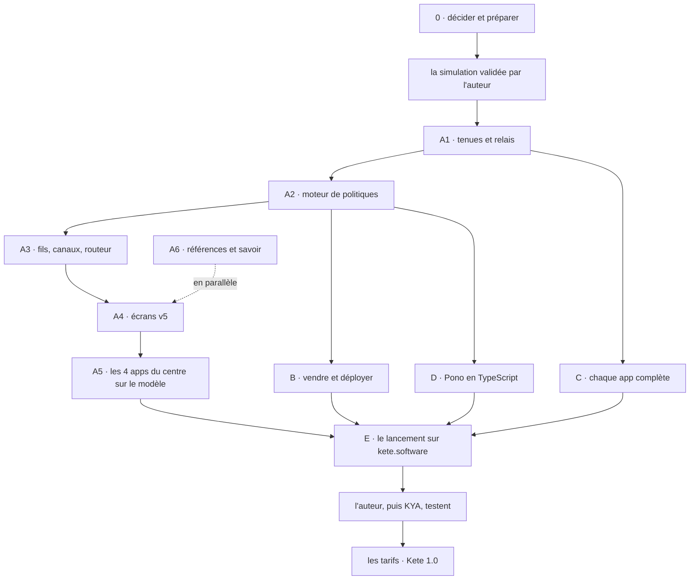

# Feuille de route

> Des étapes ordonnées par dépendances et par preuves, jamais par dates. Une étape se ferme sur sa
> preuve, pas sur une impression.

## Règles

1. **Kete Apps et Kete Consulting rapportent d'abord.** Kete Enterprise avance en parallèle depuis
   le 2026-09-30, avec KYA comme premier client autonome (D-025) ; son offre ne se vend qu'après la
   preuve de l'étape 4.
2. **Un métier à la fois** dans Kete Apps.
3. **La doctrine avant le code** : chaque produit renvoie à ce dépôt.
4. **On ne construit que ce qui a déjà fait mal.** Mais ce qui est manifestement commun se
   construit dès la première fois comme un module autonome, réutilisable partout (D-059).
5. **Chaque app livrée a sa démo publique et Kete Intelligence** (D-059) ; les tarifs viennent
   quand tout est implémenté.

## Étape 0 — La maison posée

- [x] Organisation GitHub `kete-africa`, dépôt `kete`, logo importé.
- [ ] Nom sécurisé : kete.software (D-059), dépôt OAPI, comptes sur les réseaux.
- [ ] Société : Vitatech → Kete (dénomination au RCCM ou nouvelle société), avec un comptable.
- [ ] Vision, mandat et horizons complétés par l'auteur (`FONDEMENT.md`, `VISION.md`, `MANDAT.md`).
- [x] Style visuel tranché : v1 rectangle (D-010) ; reste `@kete/design`.

**Preuve** : un client peut signer un contrat avec Kete, et chaque affirmation du site a sa ligne
dans le registre de vérité.

## Étape 1 — Kete Cockpit V0

- [ ] Contrats v1 : manifeste, événement, santé.
- [ ] SDK TypeScript et Python (outbox, envoi, signature, santé, manifeste).
- [ ] Registre, réception des événements, sondes, instantanés, brief Telegram, MCP en lecture.
- [ ] Une app réelle branchée (Nettio ou Firmo).

**Preuve** : un événement parti de l'app en production apparaît dans le brief du lendemain ; une
panne simulée déclenche une alerte ; l'agent répond sur l'état des apps.

## Étape 2 — Un métier gagné dans Kete Apps

- [ ] Choisir le métier (Nettio ou Firmo) et le tarif au rythme de la recette.
- [ ] Compte Kete (Better Auth, e-mail) et paiement par Chariow, via Mon espace Kete.
- [ ] La carte de vérification et les brouillons préparés par l'agent.

**Preuve** : des clients payants l'utilisent encore après 90 jours.

## Étape 3 — Kete Consulting

- [ ] L'offre Kete Diagnostic, son livrable type et son prix.
- [ ] Un premier diagnostic réel.

**Preuve** : un diagnostic livré, compris sans explication, et une décision prise grâce à lui.

## Étape 4 — Kete Enterprise · _commencée le 2026-09-30 (D-025)_

- [ ] Propriété de KYA-Platform clarifiée par écrit, avant la mise en production chez KYA.
- [ ] Dépôt `kete-africa/kete-enterprise` : la chaîne d'une entreprise (D-028), avec sa propre
      feuille de route par phases (D-021).
- [ ] KYA-Platform : une instance autonome sur les serveurs de KYA, sa configuration et ses apps
      dans les dépôts de KYA, jamais un fork (D-025).
- [ ] L'instance partagée et ses tenants, administrés par la flotte du Cockpit (D-026, D-027).
- [ ] Catalogue de capacités et d'outils open source validés.
- [ ] **L'unification (D-056 à D-058)**, dans cet ordre : décider ; une simulation complète du
      flux, validée par l'auteur ; les tenues et le relais ; le moteur de politiques ; les fils et
      les canaux ; les écrans d'après une maquette v5 validée ; les références (lieux, actifs,
      catalogue, groupe) et le savoir ; les quatre apps sur le modèle unifié ; le parcours complet
      dans la démo ; les vrais comptes branchés. L'auteur puis KYA testent à la fin. Le détail est dans « La sortie de Kete 1.0 » ci-dessous.

**Preuve** : des gains mesurés chez le pilote, publiés avec leur preuve.

## La sortie de Kete 1.0 — le plan complet (tranché le 2026-10-16)

L'auteur (« Écris le plan complet »), après D-056 à D-059. Cinq voies, dans un ordre de
dépendances ; chaque étape se ferme sur sa preuve. L'auteur, puis KYA, testent à la fin ; les tarifs
viennent quand tout est implémenté (D-059).

**Une app est terminée** quand elle a : Kete Intelligence à l'intérieur (principe 9), sa démo
publique jouable sans compte (principe 8), ses événements et sa santé envoyés au Cockpit, ses écrans
comparés à une maquette validée, sa documentation et ses schémas.

### Étape 0 — Décider et préparer

- [ ] Fusionner la doctrine D-056 à D-059 (`kete`), les décisions 0011 et 0012 et les specs 111 à
      113 (`kete-core`), la décision 0002 (`kete-enterprise`).
- [ ] Les cinq questions de la décision 0012 répondues par l'auteur : Cedar à l'essai ; WhatsApp en
      direct ou par un fournisseur agréé ; la transcription ; le dimensionnement solaire ;
      l'agrégateur de mobile money.
- [ ] Finir la spec 085 de Kete Enterprise (le cadre et Kete Intelligence sur les paquets du socle).
- [ ] La simulation du système validée par l'auteur.

**Preuve** : l'auteur a joué la simulation et dit que le flux tient.

### Voie A — L'unification, le cœur du produit

| Étape | Où | Livre | Preuve |
| --- | --- | --- | --- |
| A1 | `kete-core` 111, `kete-enterprise` 087 | `@kete/work` : la tenue, « jamais personne », le relais ; les six sources d'Enterprise branchées ; « Pour moi » | Une absence déplace ses tenues le jour même |
| A2 | `kete-core` 112, `kete-enterprise` 088 | `@kete/policies` (Cedar) : un moteur au geste ; circuits et règles fondus ; les six politiques | Le même geste, personne ou agent, passe par la même politique |
| A3 | `kete-core` 113, `kete-enterprise` 089 | `@kete/threads`, `@kete/channels` : fils, groupes, trace, pont mail, WhatsApp, routeur | Un message client arrive dans le fil de son projet avec un responsable |
| A4 | `kete-core` (`shell`, `design`), `kete-enterprise` 090 | La maquette v5 validée, puis les écrans : « Pour moi », le fil et son état, le fil « Kete », Planifier, Mon tableau, un agent, le téléphone | Chaque écran à côté de la maquette, ordinateur et téléphone, clair et sombre |
| A5 | les 4 apps du centre | Kete Finance, Team, Commitments, Support sur le modèle unifié | Chaque app écrit ses tenues et passe ses gestes par les politiques |
| A6 | `kete-core`, `kete-enterprise` | Les références : lieux, actifs et parc installé, catalogue, groupe ; le savoir unifié | Le dimensionnement solaire tire ses prix du catalogue et l'ensoleillement du lieu |

### Voie B — Vendre et déployer Kete Enterprise (dès A2)

| Étape | Où | Livre | Preuve |
| --- | --- | --- | --- |
| B1 | `kete-core` | `@kete/connections` (connexions et secrets scellés), `@kete/metering` (la consommation), `@kete/infrastructure` (le port de provisionnement et ses adaptateurs : Coolify, Neon ou Postgres, S3, DNS, secrets, sauvegardes) | Une instance de test créée puis détruite par le port seul |
| B2 | `kete-cockpit` | La Flotte : provisionner, suivre (santé, version, sauvegardes restaurées, incidents, consommation), mettre à jour, revenir en arrière ; sans jamais lire les données d'un client | Une mise à jour poussée à deux instances, une sauvegarde restaurée |
| B3 | `kete-core` (Compte Kete, Mon espace) | Le déploiement en libre-service : une entreprise s'inscrit, choisit son mode (partagé, dédié, chez elle, autonome), sa région, ses apps ; paie ; son Kete est prêt | Une organisation inscrite trouve son Kete Enterprise prêt, sans geste de Kete |
| B4 | `kete-core` | La facturation centralisée dans le Compte Kete, derrière le port de paiement | Un abonnement payé ouvre les apps choisies |

### Voie C — Chaque app complète (dès A1)

| Étape | Où | Livre |
| --- | --- | --- |
| C1 | `kete-cockpit` | Le suivi de toutes les Kete Apps : événements, santé, manifeste, chiffres ; le brief du matin ; l'agent par MCP |
| C2 | `nettio`, `firmo`, `nyatefe` | Kete Intelligence dedans, la démo publique, les événements au Cockpit ; Nyatefe décrit par l'auteur avant d'être construit |
| C3 | les 4 apps du centre, `kete-cockpit`, Kete Enterprise | La même chose pour chacune : Kete Intelligence, la démo publique, le suivi |

**Preuve** : chaque app de la liste ouvre sa démo publique sans compte et apparaît au Cockpit.

### Voie D — Pono en TypeScript (dès A2)

- [ ] D1 · La décision : Pono réécrit en TypeScript sur `kete-core`, absorbant l'usine (`apps/factory`).
- [ ] D2 · Le cœur : projets, environnements (Git, Neon, cible de déploiement), runtime derrière le port
      de bac à sable (Boat après essai), garde-fous et mises en production (sur `@kete/lifecycle`,
      `@kete/policies`, `@kete/work`), validation depuis le téléphone, journal.
- [ ] D3 · Les dépôts de Kete passent par Pono ; puis le premier skill (une landing page Chariow) ; la
      démo publique de Pono.

**Preuve** : une modification demandée depuis un téléphone donne une preview avec sa propre base,
testée, puis publiée après validation, sans ouvrir d'ordinateur.

### Voie E — Le lancement sur kete.software

- [ ] E1 · La vision réécrite et validée par l'auteur (`VISION.md`), le positionnement à jour.
- [ ] E2 · Le site `kete.software` : la promesse, les trois parties, les démos jouables, l'inscription
      vers le Compte Kete ; le site de Pono à part.
- [ ] E3 · La documentation, les conditions d'utilisation, la confidentialité, l'accord de traitement
      des données, la page d'état des services, le support par Support.
- [ ] E4 · Les sauvegardes restaurées, une revue de sécurité, la production en place.
- [ ] E5 · Les vrais comptes branchés (WhatsApp Business, IMAP, la clé du modèle) ; l'auteur, puis KYA,
      testent ; les corrections.
- [ ] E6 · Les tarifs ; la sortie de Kete 1.0.

**Preuve** : une entreprise inconnue s'inscrit sur kete.software, joue une démo, déploie son Kete et
l'utilise, sans aide.

### Ce qui dépend de l'auteur

Les cinq questions de la décision 0012 ; la validation de la simulation, puis de la maquette v5 ; ce
que fait Nyatefe ; la structure juridique qui vend Kete ; l'hébergeur de la zone clients ; la
validation de la vision ; les vrais comptes ; les tarifs à la fin.

## Plus tard

Agent WhatsApp et guichet Kete pour les commerçants · voix et langues locales · couche parc sur
toutes les instances · rapports mensuels clients · Kete Cockpit ouvert aux autres porteurs de
produits.
